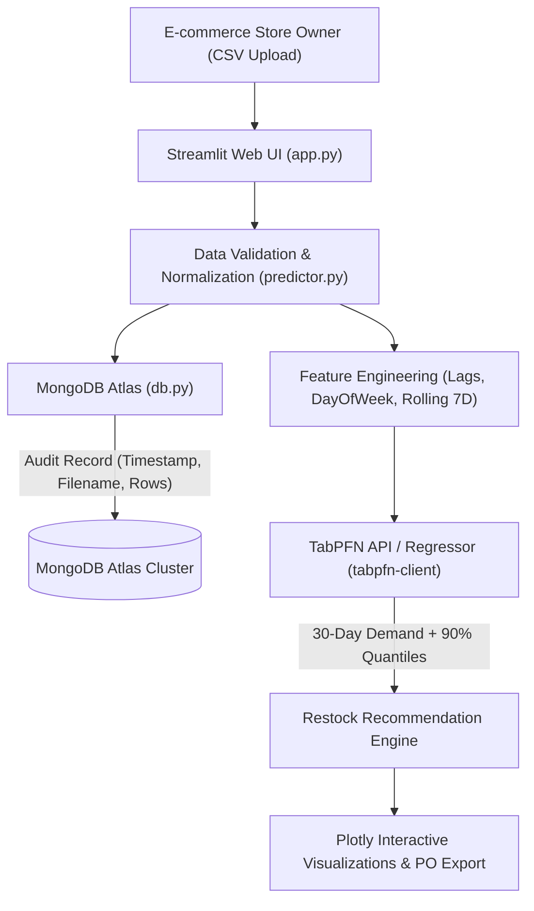

# ⚡ Restock-Predictor: Premium AI Inventory Intelligence

> **A High-Aesthetic Minimum Viable Product (MVP) for e-commerce side hustles and independent makers (Etsy/Shopify), submitted for the DEV.to Hacktoberfest Open-Source AI Challenge.**

[](https://dev.to)
[](https://render.com)
[](https://priorlabs.ai)
[](https://www.mongodb.com/atlas)
[](https://streamlit.io)
[](https://plotly.com)

---

## 🌟 Executive Summary & Problem Statement

Independent e-commerce makers frequently face the **"Inventory Trap"**:
1. **Stockouts**: Missing out on sudden weekend surges and leaving money on the table.
2. **Dead Stock**: Over-purchasing slow-moving catalog items and tying up critical working capital.

Traditional time-series forecasting requires extensive statistical tuning (ARIMA stationarity, Prophet holidays, or iterative GBDTs like XGBoost). Meanwhile, attempting to use standard LLMs (like GPT-4) fails due to **token arithmetic hallucinations, linear drift failures, and extreme prompt token costs**.

**Restock-Predictor** solves this with a **TabPFN (Prior-Data Fitted Network)** foundation model — performing zero-shot in-context regression in sub-second inference. Combined with **MongoDB Atlas** for audit logging and **Streamlit + Plotly** styled in an obsidian glassmorphism SaaS theme, store owners can upload their sales CSV and get a 30-day restock plan with statistical 90th-percentile safety stock buffers in under 2 seconds.

---

## 🎨 UI/UX & Aesthetic Highlights

- **Obsidian Dark Palette & Glassmorphic SaaS Cards**: Custom theme defined in `.streamlit/config.toml` (`#0B0F19` background, `#6366F1` electric indigo accents, translucent glass cards with backdrop blur).
- **Interactive Plotly Multi-Series Charts**: Dark-mode interactive time-series charts featuring historical actuals, TabPFN forecasts, and shaded 90% confidence / safety buffer bands.
- **KPI Metrics with Colored Deltas**: Top-level performance metrics displaying growth deltas (`+X.X% vs prior 30d`) and safety buffer volatility percentages.
- **Styled Gradient Purchase Order Table**: Procurement summary styled with continuous color gradients for immediate prioritization.
- **Tab Navigation**: Clean separation into Forecasting, Purchase Orders, Demand Trends, MongoDB Atlas Audit, and Technical Architecture.

---

## 🧠 Why TabPFN Beats Standard LLMs for Tabular Data

| Dimension | Standard LLMs (e.g. GPT-4 / Claude) | TabPFN Tabular Foundation Model |
| :--- | :--- | :--- |
| **Numerical Reasoning** | Treats numbers as discrete BPE tokens; prone to arithmetic hallucinations | Specialized transformer trained on synthetic continuous mathematical priors |
| **Inference Latency** | Multi-second streaming autoregression ($O(N)$ token generation) | **Single forward pass across entire tabular matrix (< 500ms)** |
| **Uncertainty & Buffers** | Qualitative descriptions ("demand might increase") | **Native probabilistic output distributions & 90th-percentile quantiles** |
| **Hyperparameter Tuning** | Prompt engineering trial-and-error | Zero-shot in-context learning with zero tuning needed |
| **Privacy & Cost** | Sends raw store history over chat APIs; high token fees | Structured matrix ingestion; compact, private, and cost-effective |

---

## 🏗️ Architecture & Data Flow



---

## 📂 Project Structure

```
restock-predictor/
├── .streamlit/
│   └── config.toml     # Global theme configuration (Obsidian & Electric Indigo)
├── app.py              # Main Streamlit dashboard with custom CSS, Plotly & tabs
├── db.py               # MongoDB Atlas connection, ping test & audit logging logic
├── predictor.py        # TabPFN API client, feature engineering & local fallback
├── requirements.txt    # Production dependencies (Streamlit, Plotly, TabPFN, Mongo)
├── render.yaml         # Render Infrastructure as Code (IaC) blueprint ($200 category)
├── sample_data.csv     # 90-day baseline across 3 Etsy/Shopify inventory SKUs
├── .env.example        # Environment variable template
└── README.md           # Documentation & Hacktoberfest technical write-up
```

---

## 🚀 Quickstart (Local Development)

### 1. Set Up Virtual Environment

```bash
cd restock-predictor
python -m venv venv

# On Windows:
venv\Scripts\activate

# On macOS/Linux:
source venv/bin/activate

# Install dependencies:
pip install -r requirements.txt
```

### 2. Configure Environment Variables

Create `.env` from template:

```bash
cp .env.example .env
```

Variables:
- `MONGO_URI`: Your MongoDB Atlas connection string (e.g. `mongodb+srv://...`).
- `TABPFN_API_KEY`: Your Prior Labs API token from [platform.priorlabs.ai](https://platform.priorlabs.ai).

*(Note: If either key is omitted, the app gracefully falls back to local session auditing and high-fidelity local tabular regression so you can test immediately without credentials).*

### 3. Run the Application

```bash
streamlit run app.py
```

Open `http://localhost:8501` in your browser. Click **"Load Pre-Packaged Sample CSV"** in the sidebar to test the full pipeline instantaneously!

---

## ☁️ Deploying to Render ($200 Best Use of Render Prize)

This project includes a turnkey `render.yaml` Infrastructure as Code blueprint designed to qualify for the **$200 Best Use of Render** hackathon category.

1. Push this repository to GitHub.
2. In the [Render Dashboard](https://dashboard.render.com), click **New +** > **Blueprint**.
3. Select your GitHub repository.
4. Render automatically parses `render.yaml` and configures:
   - Python 3.11 web service
   - Automatic port binding (`--server.port $PORT --server.address 0.0.0.0`)
   - Health checks at `/_stcore/health`
5. In the **Environment** tab on Render, add:
   - `MONGO_URI`
   - `TABPFN_API_KEY`
6. Click **Apply Changes** — your app is live!

---

## 📊 Sample Dataset Baseline (`sample_data.csv`)

Includes 270 rows representing 90 continuous days of sales across 3 distinct inventory archetypes:
1. `SKU-SOY-CANDLE`: High-demand Etsy staple with prominent weekend surges.
2. `SKU-CERAMIC-MUG`: Consistent, low-variance baseline staple.
3. `SKU-LINEN-TOTE`: High-growth trending product with upward velocity.

---

## 📜 License

Distributed under the MIT License. Built for the DEV.to Hacktoberfest Open-Source AI Challenge.
